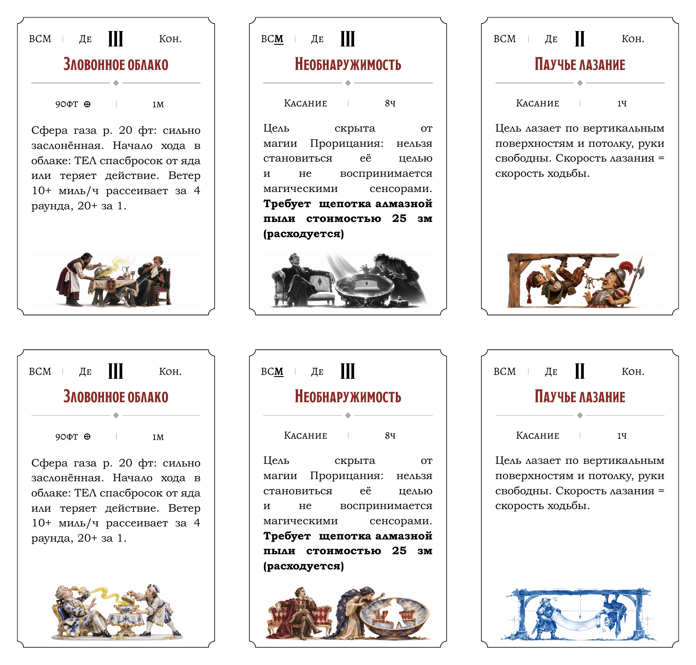

# Альтернативные стили для карт заклинаний

В этой пробе три сюжета нарисованы дважды. В обоих рядах одинаковы текст карты, чёрная рамка, ширина виньетки (48,58 мм) и зазор от нижнего штриха до рамки (2 мм). Так можно сравнить, как материал поддерживает шутку и как край рисунка переходит в белую бумагу.

## Зловонное облако

Слуга поднимает крышку супницы, гость прикрывает нос.

- **Историческое кино.** Холодный оконный свет ловит серебряную крышку и складки льняной салфетки. Гость сохраняет придворную осанку, а борзая уже выбирается из-под стола. Под ножками достаточно коротких теней; остальное пространство занимает белое поле. [Виньетка крупно](resources/cinema.png)
- **Расписной фарфор.** Запах становится жёлтым глазурованным завитком между супницей и носом гостя. Кобальтовая роспись и тонкая позолота читаются даже в миниатюре. Светлый край фарфоровой подставки почти растворяется в бумаге. [Виньетка крупно](resources/porcelain.png)

## Необнаружимость

Вельможа сидит на скамье, а прорицатель видит в чаше ту же скамью пустой.

- **Оккультный нуар.** Серебристо-чёрный фотокадр. Тёмная одежда собирает фигуры в два силуэта, одинаковый ромб на обивке позволяет узнать скамью в чаше. Косой луч и засвеченные края связывают кадр с белым полем. [Виньетка крупно](../profiles/styles/noir/resources/noir.png)
- **Бумажный фотоколлаж.** Вельможа и прорицатель собраны из гравюр и старых фотографий. В чаше фигура вельможи вырезана из изображения: белая прорезь делает исчезновение видимым. Рваные кромки обивки и костюмов задают естественный край сценки. [Виньетка крупно](resources/collage.png)

## Паучье лазание

Разбойник держится подошвами за нижнюю сторону балки. Обе руки свободны, и он спокойно читает свиток.

- **Деревянные марионетки.** Шарниры и лак подчёркивают позу перевёрнутой куклы. Ключи с пояса свисают к носу стражника и выдают направление тяжести. Обломок балки и дверной косяк обозначают помещение; между фигурами просвечивает бумага. [Виньетка крупно](resources/puppet.png)
- **Архитектурная цианотипия.** Потолок и пол заданы чертёжными линиями, отвес проходит между героями. Они читают один свиток с противоположных концов. Прусская синь уходит в белый через прерывистый отпечаток по краям балки и пола. [Виньетка крупно](resources/cyanotype.png)

При следующей пробе сохраняйте крупный жест, по которому узнаётся заклинание. Смотрите на картинку в печатном масштабе: остаётся ли различим ромб в чаше, видна ли щель между балкой и головой куклы, читается ли фарфоровый завиток на фоне супницы. Для серийной колоды используется [утверждённая инструкция по ксилографии](../profiles/styles/woodcut/woodcut.md).
